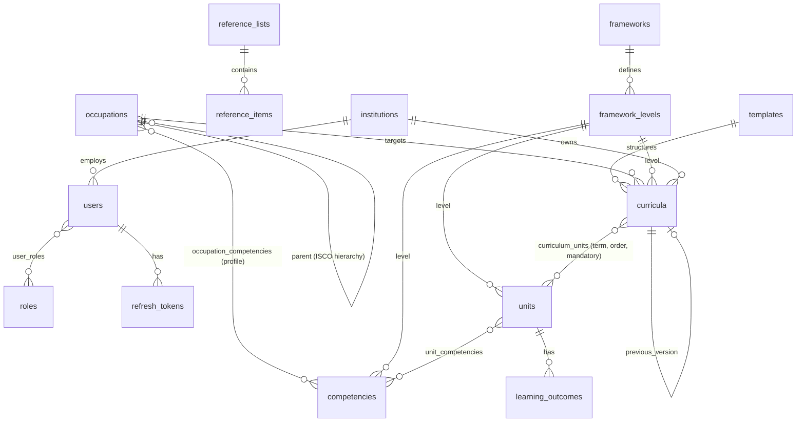

# Data model

Source of truth: `apps/api/src/database/schema.ts`. SQL migrations: `apps/api/drizzle/`.

Plus: `workflow_events` (status history for any controlled entity), `files` (attachment
metadata), `notifications`, `audit_logs` (append-only).

## Conventions

| Concern | Rule |
|---|---|
| Keys | UUID primary keys (`gen_random_uuid()`); human `code` is the business identifier |
| Uniqueness | `UNIQUE (lower(code))` — case-insensitive; curricula: `(lower(code), version)`; reference items: `(list_id, lower(code))`; framework levels: `(framework_id, level)` |
| Bilingual | `*_en` / `*_ar` column pairs |
| Concurrency | `row_version` integer on every mutable table — optimistic locking on every update/transition |
| Timestamps | `created_at`, `updated_at` (timestamptz), `created_by_id`, `updated_by_id` |
| Status | `record_status` enum: draft, in_review, approved, published, archived |
| Deletion | FKs to shared records are `ON DELETE RESTRICT`; link rows cascade only from their owner; files are soft-deleted; audit rows can never be deleted |

## Integrity controls (database level)

| Control | Where |
|---|---|
| Referenced competencies/units/levels/occupations/templates cannot be deleted | FK `RESTRICT` |
| No self-parent occupation | `CHECK occupations_not_self_parent` |
| No cycles in occupation hierarchy | trigger `occupations_prevent_cycle` (migration 0002) |
| Non-negative hours | `CHECK units_hours_nonneg` |
| Audit log append-only (UPDATE/DELETE/TRUNCATE rejected) | triggers `audit_logs_no_update`, `audit_logs_no_truncate` |
| Duplicate prevention | case-insensitive unique indexes |

## Integrity controls (application level)

- Content of controlled records is editable only in `draft`; changes to published records
  require returning to draft (catalogue) or **creating a new version** (curricula).
- Hierarchy level rules: parent must be a higher ISCO level; only `major_group` may be root;
  competencies link only to `occupation`-level nodes.
- Publishing requires dependencies to be published (unit → its competencies; curriculum → its
  units, occupation and template). Archiving is blocked while published records depend on it.
- Reference-item codes are immutable; items are deactivated instead of deleted.
- Imports create drafts only and are all-or-nothing.

## Indexes

FK columns used in joins (`*_idx`), status, institution and occupation on curricula, trigram
GIN indexes on `title_en` of occupations, competencies, units and curricula for search, and
audit indexes on `(entity_type, entity_id)`, `actor_id`, `occurred_at`.

## Personal data held

`users`: e-mail, names (EN/AR), institution, last login, hashed password (argon2id), lockout
counters. `audit_logs`/`refresh_tokens`: IP address and user agent. No national ID, phone,
birth date or learner data is stored — see docs/security.md §6 for retention.
